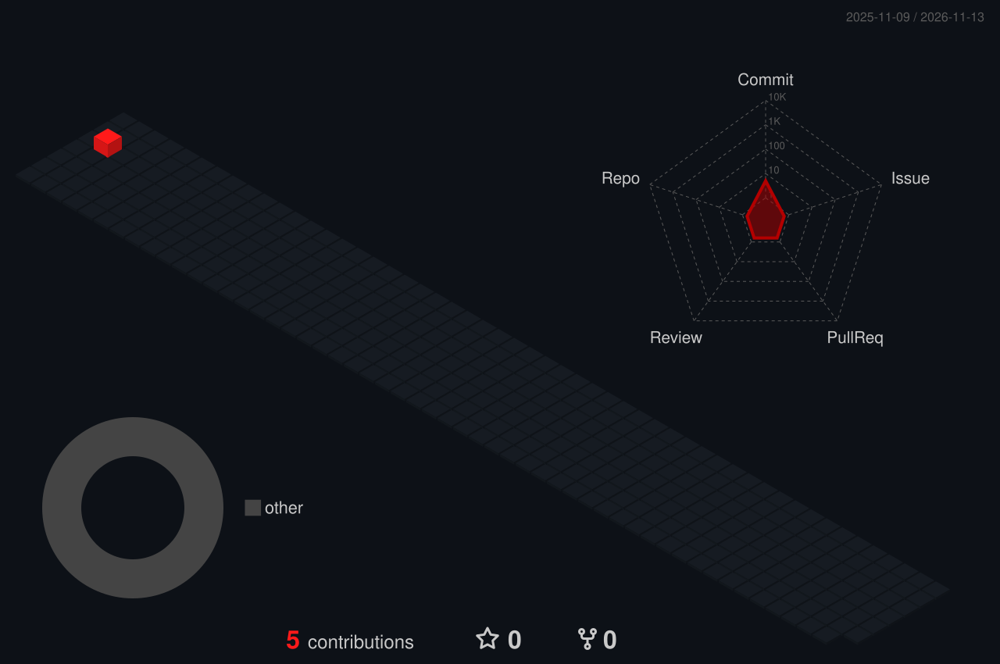

<div align="center">



<a href="https://github.com/bodepika?tab=followers"></a>
<a href="https://github.com/bodepika?tab=repositories"></a>


<br><br>


<br><br>

 whoami" />

</div>

```console
root@shadow:~# whoami
  pentester · red team · offensive security

root@shadow:~# cat /etc/motd
  access is never denied. only delayed.

root@shadow:~# ls ~/work
  ls: cannot open directory '/home/bodepika/work': Permission denied
```

> [!CAUTION]
> This session is being logged.
>
> What you see here is only the surface.

<div align="center">

<br>

 arsenal" />

<br><br>


<br><br>


<br><br>

 contributions" />

<br><br>



<br><br>

 traces" />

<br><br>


<br><br>

 exit" />

<br><br>

<sub><code>// if you need to find me, you already know how.</code></sub>

</div>
